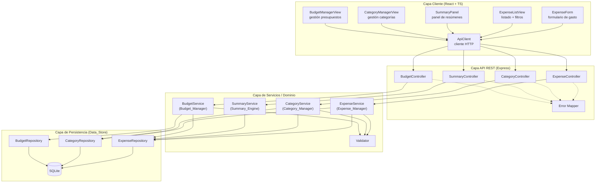
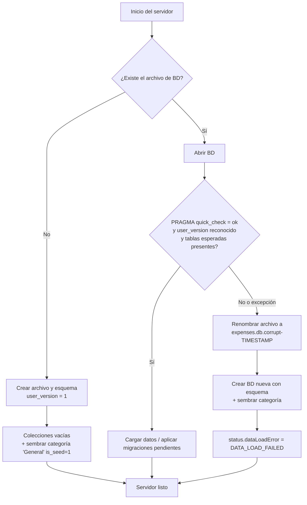

# Documento de Diseño

## Overview

El Seguidor de Gastos (Expense Tracker) es una aplicación web full-stack para un único usuario que permite registrar, editar, eliminar, clasificar, filtrar y analizar gastos personales, además de definir presupuestos con alertas. Este documento describe la arquitectura técnica que satisface los 8 requisitos definidos en `requirements.md`.

### Stack tecnológico

- **Frontend**: React + TypeScript (SPA).
- **Backend**: Node.js + Express, escrito en TypeScript, exponiendo una API REST.
- **Base de datos**: SQLite.
- **Testing**: Vitest (unit e integración), fast-check (property-based testing), Supertest (integración HTTP).

### Justificación de la base de datos: SQLite

Se elige **SQLite** frente a PostgreSQL por las siguientes razones:

- La aplicación es de **uso personal y de un solo usuario** (ver glosario `User` en requirements.md), sin concurrencia relevante ni necesidad de un servidor de base de datos separado.
- SQLite es **embebida y sin configuración**: el almacenamiento es un único archivo, lo que simplifica el despliegue y las copias de seguridad.
- Soporta transacciones ACID, suficientes para garantizar la atomicidad exigida por los requisitos 1.3, 2.5, 3.6 y 8.4 (rechazar la operación y conservar el estado previo si la persistencia falla).

Para no quedar atados a SQLite, el diseño introduce una **capa de acceso a datos basada en interfaces de repositorio** (`ExpenseRepository`, `CategoryRepository`, `BudgetRepository`). La lógica de dominio depende solo de esas interfaces, de modo que migrar a PostgreSQL implica únicamente proporcionar una nueva implementación de los repositorios sin tocar el dominio ni la API. Se usará SQL estándar y tipos de columna compatibles entre ambos motores siempre que sea posible.

### Decisión de representación monetaria

Los `Amount` se almacenan y se operan como **enteros en céntimos** (`INTEGER`), no como números de punto flotante. Esto evita los errores de redondeo del tipo `float`/`double` y garantiza de forma natural la exactitud de dos decimales exigida por el glosario `Amount` y por el requisito 6.5. La conversión a la representación con dos decimales (`123.45`) ocurre solo en los límites del sistema (serialización de la API y renderizado de UI). Rango permitido: `1` a `99_999_999_999` céntimos (equivalente a 0.01–999,999,999.99).

## Architecture

La aplicación se organiza en cuatro capas con dependencias dirigidas hacia el dominio:

1. **Capa cliente (React)**: vistas y componentes de interfaz. Realiza validación de entrada para retroalimentación inmediata y consume la API REST. No contiene lógica de negocio autoritativa.
2. **Capa API REST (Express)**: controladores y rutas HTTP. Traduce peticiones HTTP a llamadas al dominio, serializa respuestas y mapea errores de dominio a códigos HTTP.
3. **Capa de servicios/dominio**: contiene `Expense_Manager`, `Category_Manager`, `Summary_Engine`, `Budget_Manager` y `Validator`. Aquí reside toda la lógica de negocio autoritativa y las reglas de validación. Es independiente de HTTP y del motor de base de datos.
4. **Capa de persistencia (Data_Store)**: implementaciones de repositorio sobre SQLite. Encapsula el SQL y las transacciones.

La **validación autoritativa ocurre siempre en el servidor** (capa de dominio). La validación en el cliente es un espejo de las mismas reglas para mejorar la experiencia de usuario, pero nunca sustituye a la del servidor.

### Mapeo de componentes del glosario a la arquitectura

| Componente (glosario) | Ubicación en la arquitectura | Responsabilidad principal |
|-----------------------|------------------------------|---------------------------|
| `Expense_Manager` | Capa de dominio (`ExpenseService`) | Crear, editar y eliminar gastos (Req 1, 2, 3) |
| `Category_Manager` | Capa de dominio (`CategoryService`) | Gestionar categorías y sus restricciones (Req 4) |
| `Expense_List_View` | Capa cliente + endpoint de consulta | Listar, ordenar, filtrar y buscar gastos (Req 5) |
| `Summary_Engine` | Capa de dominio (`SummaryService`) | Calcular totales y resúmenes por periodo/categoría (Req 6) |
| `Budget_Manager` | Capa de dominio (`BudgetService`) | Gestionar presupuestos y generar alertas (Req 7) |
| `Data_Store` | Capa de persistencia (repositorios + SQLite) | Persistir y recuperar datos, manejar arranque y corrupción (Req 8) |
| `Validator` | Capa de dominio (módulo `validators`) | Validar entradas antes de persistir (Req 1, 2, 4, 7) |

## Components and Interfaces

### Diagrama de componentes



### Interfaces de dominio (TypeScript)

```typescript
// Resultado uniforme: éxito con valor o fallo con errores de dominio tipados.
type Result<T> =
  | { ok: true; value: T }
  | { ok: false; errors: DomainError[] };

interface DomainError {
  code: ErrorCode;      // enum estable, mapeable a HTTP y a mensajes
  message: string;      // mensaje en español exigido por los requisitos
  field?: string;       // campo asociado (amount, date, category, description...)
}

interface ExpenseService {               // Expense_Manager (Req 1, 2, 3)
  create(input: ExpenseInput): Result<Expense>;
  update(id: string, input: ExpenseInput): Result<Expense>;
  delete(id: string): Result<void>;
  get(id: string): Result<Expense>;                 // EXPENSE_NOT_FOUND | DATA_READ_FAILED
  list(filter: ExpenseFilter): Result<Expense[]>;   // Expense_List_View (Req 5); DATA_READ_FAILED
}

interface CategoryService {              // Category_Manager (Req 4)
  create(name: string): Result<Category>;
  rename(id: string, name: string): Result<Category>;
  delete(id: string): Result<void>;
  list(): Result<Category[]>;            // DATA_READ_FAILED si falla la lectura
}

// Periodo pedido al Summary_Engine: para day/week/month la fecha de referencia es opcional
// (por defecto Clock.today()); el servicio lo resuelve con resolvePeriod.
type SummaryPeriodRequest =
  | { type: 'day' | 'week' | 'month'; referenceDate?: string }
  | { type: 'custom'; dateFrom: string; dateTo: string };

interface SummaryService {               // Summary_Engine (Req 6)
  // INVALID_DATE / INVALID_DATE_RANGE, DATA_READ_FAILED, TOTAL_OUT_OF_RANGE
  totalForPeriod(request: SummaryPeriodRequest): Result<Money>;
  summaryByCategory(request: SummaryPeriodRequest): Result<CategorySummary[]>;
}

interface BudgetService {                // Budget_Manager (Req 7)
  create(input: BudgetInput): Result<Budget>;
  update(id: string, input: BudgetInput): Result<Budget>;
  delete(id: string): Result<void>;
  get(id: string): Result<Budget>;       // BUDGET_NOT_FOUND | DATA_READ_FAILED
  list(): Result<Budget[]>;              // DATA_READ_FAILED si falla la lectura
  evaluateAlerts(period: Period): Result<BudgetAlert[]>; // DATA_READ_FAILED si falla la lectura
}

// Lecturas: un PersistenceError se traduce a DATA_READ_FAILED. Escrituras: a EXPENSE_SAVE_FAILED,
// EXPENSE_DELETE_FAILED (gastos) o PERSISTENCE_FAILED (categorías y presupuestos).
// Cualquier otra excepción se propaga al ErrorMapper (INTERNAL_ERROR).

// Repositorios: frontera con el Data_Store, intercambiables (SQLite / PostgreSQL).
interface ExpenseRepository {
  insert(e: Expense): void;              // lanza PersistenceError si falla
  updateById(id: string, e: Expense): boolean; // false si no existe
  deleteById(id: string): boolean;       // false si no existe
  findById(id: string): Expense | null;
  query(filter: ExpenseFilter): Expense[];
  sumByCategoryInPeriod(period: Period): Map<string, number>; // céntimos
  countByCategory(categoryId: string): number;
}

interface CategoryRepository {
  insert(c: Category): void;
  updateById(id: string, c: Category): boolean;
  deleteById(id: string): boolean;
  findById(id: string): Category | null;
  findByNameInsensitive(name: string): Category | null;
  list(): Category[];
}

interface BudgetRepository {
  insert(b: Budget): void;
  updateById(id: string, b: Budget): boolean;
  deleteById(id: string): boolean;
  findById(id: string): Budget | null;
  findByCategoryAndPeriod(categoryId: string, period: Period): Budget | null;
  list(): Budget[];
  countByCategory(categoryId: string): number;
}
```

### Diseño de la API REST

Prefijo común: `/api`. Todos los `amount`/`limit` se transportan en la respuesta/petición como **string decimal de dos decimales** (p. ej. `"123.45"`) para evitar la pérdida de precisión del `number` de JSON; internamente se convierten a céntimos.

Formato de error uniforme (cuerpo de respuesta en fallos):

```json
{ "errors": [ { "code": "AMOUNT_NOT_POSITIVE", "message": "El monto debe ser mayor que cero.", "field": "amount" } ] }
```

#### Gastos (Expense_Manager — Req 1, 2, 3)

| Método | Ruta | Descripción | Éxito | Errores |
|--------|------|-------------|-------|---------|
| POST | `/api/expenses` | Crear gasto | 201 + Expense con `id` (Req 1.1, 1.2) | 400 validación (Req 1.4–1.8), 500 persistencia (Req 1.3) |
| PUT | `/api/expenses/:id` | Editar gasto | 200 + Expense actualizado (Req 2.1, 2.2) | 400 validación (Req 2.4), 404 no existe (Req 2.3), 500 |
| DELETE | `/api/expenses/:id` | Eliminar gasto | 204 (Req 3.2, 3.4) | 404 no existe (Req 3.5), 500 (Req 3.6) |
| GET | `/api/expenses` | Listar/filtrar/buscar | 200 + Expense[] ordenado (Req 5) | 400 rango inválido (Req 5.4), 500 `DATA_READ_FAILED` |
| GET | `/api/expenses/:id` | Obtener uno | 200 + Expense | 404, 500 `DATA_READ_FAILED` |

La confirmación de borrado (Req 3.1, 3.3) es responsabilidad de la UI; el backend solo ejecuta la eliminación tras la confirmación.

Parámetros de consulta de `GET /api/expenses` (Req 5):

- `categoryId` (string) — filtro exacto por categoría (Req 5.2).
- `dateFrom`, `dateTo` (YYYY-MM-DD) — rango inclusivo (Req 5.3). Si `dateFrom > dateTo` → 400 (Req 5.4).
- `search` (1–100 chars) — subcadena en descripción, insensible a mayúsculas y acentos (Req 5.5).
- La combinación de parámetros se aplica en conjunción lógica (Req 5.6). Resultado vacío → 200 con lista `[]` (la UI muestra el mensaje de "sin coincidencias", Req 5.7).

#### Categorías (Category_Manager — Req 4)

| Método | Ruta | Descripción | Éxito | Errores |
|--------|------|-------------|-------|---------|
| GET | `/api/categories` | Listar categorías | 200 + Category[] (Req 4.7) | 500 `DATA_READ_FAILED` |
| POST | `/api/categories` | Crear categoría | 201 + Category (Req 4.1) | 400 nombre inválido (Req 4.2), 409 duplicado (Req 4.4) |
| PUT | `/api/categories/:id` | Renombrar categoría | 200 (Req 4.3) | 400, 409 |
| DELETE | `/api/categories/:id` | Eliminar categoría | 204 (Req 4.5) | 409 con gastos asociados (Req 4.6), 409 con presupuestos asociados (Req 4.8), 404 |

#### Resúmenes (Summary_Engine — Req 6)

| Método | Ruta | Descripción | Éxito | Errores |
|--------|------|-------------|-------|---------|
| GET | `/api/summary/total` | Total del periodo | 200 `{ "total": "0.00" }` (Req 6.1, 6.4) | 400 rango inválido (Req 6.6), 500 `DATA_READ_FAILED` / `TOTAL_OUT_OF_RANGE` |
| GET | `/api/summary/by-category` | Subtotales por categoría | 200 + `CategorySummary[]` (Req 6.2, 6.3) | 400 rango inválido (Req 6.6), 500 `DATA_READ_FAILED` / `TOTAL_OUT_OF_RANGE` |

Parámetros: `periodType` (`day`|`week`|`month`|`custom`) y, para `custom`, `dateFrom`/`dateTo`. Respuesta `by-category` omite categorías sin gastos en el periodo (Req 6.3) y devuelve `[]` si no hay gastos (Req 6.4).

#### Presupuestos (Budget_Manager — Req 7)

| Método | Ruta | Descripción | Éxito | Errores |
|--------|------|-------------|-------|---------|
| GET | `/api/budgets` | Listar presupuestos | 200 + Budget[] | 500 `DATA_READ_FAILED` |
| POST | `/api/budgets` | Crear presupuesto | 201 + Budget con `id` (Req 7.1) | 400 límite ≤ 0 (Req 7.5), 409 duplicado (Req 7.6) |
| PUT | `/api/budgets/:id` | Modificar presupuesto | 200 (Req 7.2) | 400, 409 |
| DELETE | `/api/budgets/:id` | Eliminar presupuesto | 204 | 404 |
| GET | `/api/budgets/alerts` | Evaluar alertas | 200 + BudgetAlert[] (Req 7.3, 7.4) | 400, 500 `DATA_READ_FAILED` |

La funcionalidad de presupuestos es opcional (glosario `Budget`): un flag de configuración `budgetsEnabled` habilita/deshabilita estos endpoints y las secciones de UI correspondientes.

### Componentes del frontend (React)

| Componente | Vista | Requisitos cubiertos |
|------------|-------|----------------------|
| `ExpenseForm` | Formulario de alta/edición de gasto con validación en vivo | Req 1, 2 |
| `DeleteConfirmDialog` | Diálogo de confirmación que muestra monto, categoría, fecha y descripción | Req 3.1, 3.3 |
| `ExpenseListView` | Tabla ordenada con controles de filtro (categoría, rango de fechas) y caja de búsqueda; muestra mensaje de "sin coincidencias" | Req 5 |
| `SummaryPanel` | Selector de periodo, total y desglose por categoría (lista/gráfico) | Req 6 |
| `CategoryManagerView` | Lista, alta, renombrado y borrado de categorías con sus errores | Req 4 |
| `BudgetManagerView` | Alta/edición de presupuestos y panel de alertas 80%/100% | Req 7 |
| `ApiClient` | Capa única de acceso HTTP, convierte `amount` string↔número y centraliza el manejo de errores | Todos |

Estado del cliente mediante React Query (caché de servidor, invalidación tras mutaciones) y estado local de formularios con validación en `onChange`/`onSubmit`.

## Data Models

### Modelo de dominio (TypeScript)

```typescript
type Money = number; // céntimos (entero), 1..99_999_999_999

interface Expense {
  id: string;             // UUID asignado por el sistema
  amount: Money;          // céntimos
  categoryId: string;     // FK a Category
  date: string;           // YYYY-MM-DD, no posterior a hoy
  description: string;    // 0..500 chars
  createdAt: string;      // ISO 8601, instante de creación
}

interface Category {
  id: string;             // UUID
  name: string;           // 1..50 chars, único case-insensitive
  isSeed: boolean;        // true para la categoría predefinida inicial
}

interface Budget {
  id: string;             // UUID
  limit: Money;           // céntimos, 1..99_999_999_999
  categoryId: string;     // FK a Category
  periodType: 'day' | 'week' | 'month' | 'custom';
  periodStart: string;    // YYYY-MM-DD
  periodEnd: string;      // YYYY-MM-DD, start < end
}

interface Period { type: 'day'|'week'|'month'|'custom'; start: string; end: string; }
interface CategorySummary { categoryId: string; categoryName: string; subtotal: Money; }
interface BudgetAlert {
  budgetId: string; categoryId: string;
  level: 'warning' | 'exceeded';   // 80%..<100% | >=100%
  percentConsumed: number;         // Req 7.3
  amountOver?: Money;              // monto excedido, solo en 'exceeded' (Req 7.4)
}
```

### Esquema de base de datos (SQLite)

```sql
CREATE TABLE categories (
    id          TEXT PRIMARY KEY,                 -- UUID
    name        TEXT NOT NULL CHECK (length(name) BETWEEN 1 AND 50),
    name_lower  TEXT NOT NULL,                    -- nombre normalizado minúsculas
    is_seed     INTEGER NOT NULL DEFAULT 0 CHECK (is_seed IN (0,1)),
    UNIQUE (name_lower)                           -- unicidad case-insensitive (Req 4.1, 4.4)
);

CREATE TABLE expenses (
    id           TEXT PRIMARY KEY,                -- UUID
    amount_cents INTEGER NOT NULL
                 CHECK (amount_cents BETWEEN 1 AND 99999999999), -- 0.01..999,999,999.99 (Req 1.4,1.5)
    category_id  TEXT NOT NULL REFERENCES categories(id), -- FK, impide huérfanos (Req 1.7)
    date         TEXT NOT NULL,                   -- YYYY-MM-DD, <= hoy (validado en dominio)
    description  TEXT NOT NULL DEFAULT ''
                 CHECK (length(description) BETWEEN 0 AND 500),  -- (Req 1.8, 1.9)
    created_at   TEXT NOT NULL                    -- ISO 8601
);
CREATE INDEX idx_expenses_date ON expenses(date DESC, created_at DESC); -- orden Req 5.1
CREATE INDEX idx_expenses_category ON expenses(category_id);            -- filtro/count Req 4.6,5.2

CREATE TABLE budgets (
    id           TEXT PRIMARY KEY,
    limit_cents  INTEGER NOT NULL
                 CHECK (limit_cents BETWEEN 1 AND 99999999999),          -- (Req 7.5)
    category_id  TEXT NOT NULL REFERENCES categories(id),
    period_type  TEXT NOT NULL CHECK (period_type IN ('day','week','month','custom')),
    period_start TEXT NOT NULL,
    period_end   TEXT NOT NULL,
    UNIQUE (category_id, period_start, period_end)  -- un Budget por Category+Period (Req 7.6)
);
```

Notas:

- Las restricciones `CHECK` y `UNIQUE` son una segunda línea de defensa; la validación autoritativa con los mensajes de error exactos la realiza el `Validator` en el dominio.
- La regla "fecha no posterior a hoy" (glosario `Expense`, Req 2.1) depende de la fecha actual y por tanto se valida en el dominio, no con un `CHECK` estático.
- `name_lower` se mantiene en la aplicación al insertar/renombrar; permite la unicidad e igualdad insensibles a mayúsculas sin depender de `COLLATE`.
- Las claves foráneas se activan con `PRAGMA foreign_keys = ON`.
- Para migrar a PostgreSQL: `TEXT`→`TEXT/VARCHAR`, `INTEGER`→`BIGINT` para los céntimos, y los `CHECK`/`UNIQUE` son compatibles.

## Lógica de dominio

Esta sección detalla los algoritmos de los componentes de dominio. Todas las funciones descritas son **puras** (sin E/S) salvo que se indique lo contrario, lo que permite probarlas de forma aislada con property-based testing.

### Organización del código compartido

El repositorio se organiza como monorepo con npm workspaces:

```
packages/
  shared/   # código puro compartido cliente/servidor
    money.ts        # parseAmount, formatCents
    period.ts       # resolvePeriod
    normalize.ts    # normalizeForSearch
    validators.ts   # validateExpenseInput, validateCategoryName, validateBudgetInput
    errors.ts       # ErrorCode + mensajes en español
  server/   # Express + servicios de dominio + repositorios SQLite
  client/   # React + TS
```

El paquete `shared` no tiene dependencias de Node ni del navegador. El cliente lo usa para validar en vivo y el servidor para la validación autoritativa, de modo que ambas capas aplican exactamente las mismas reglas y mensajes.

La fecha actual se obtiene a través de una interfaz `Clock { today(): string }` (formato `YYYY-MM-DD`, zona horaria local del servidor, configurable con `TZ`). Se inyecta en los servicios para que las pruebas sean deterministas.

### Conversión monetaria (céntimos ↔ string decimal)

```typescript
// Entrada: string recibido de la API o del formulario. Salida: céntimos o error.
function parseAmount(raw: string): Result<Money>;
// Entrada: céntimos (entero >= 0). Salida: string con exactamente dos decimales.
function formatCents(cents: Money): string; // 12345 -> "123.45", 0 -> "0.00", 5 -> "0.05"
```

Algoritmo de `parseAmount` (el orden define qué error se devuelve):

1. Se recorta el espacio en blanco. Si el texto no cumple `^-?\d+(\.\d+)?$`, se devuelve `AMOUNT_OUT_OF_RANGE` (formato no permitido).
2. Si el valor es negativo o igual a cero (p. ej. `"0"`, `"0.00"`, `"-3.5"`), se devuelve `AMOUNT_NOT_POSITIVE` (Req 1.4).
3. Si la parte decimal tiene más de 2 dígitos, se devuelve `AMOUNT_OUT_OF_RANGE` (Req 1.5).
4. Se calcula `cents = parteEntera * 100 + parteDecimal` con aritmética de enteros sobre los dígitos (sin `parseFloat`). Si `cents > 99_999_999_999`, se devuelve `AMOUNT_OUT_OF_RANGE` (Req 1.5).
5. En otro caso se devuelve `cents`.

`formatCents` usa `Math.trunc(cents / 100)` y `cents % 100` con relleno a dos dígitos. Como `formatCents(parseAmount(s))` produce la forma canónica de `s`, se cumple el round-trip `parseAmount(formatCents(c)) == c` para todo `c` válido.

**Redondeo (Req 6.5)**: dado que todos los montos almacenados son enteros en céntimos, cualquier suma es exacta y nunca hay fracciones de céntimo que redondear. El requisito de "exactamente dos decimales" lo garantiza `formatCents`. La regla de redondeo hacia arriba en empate solo podría aplicarse a entradas con más de dos decimales, que el `Validator` rechaza antes de llegar al `Summary_Engine`.

### Summary_Engine (Req 6)

#### Cálculo del Period

```typescript
type PeriodRequest =
  | { type: 'day' | 'week' | 'month'; referenceDate: string }   // por defecto Clock.today()
  | { type: 'custom'; dateFrom: string; dateTo: string };

function resolvePeriod(req: PeriodRequest): Result<Period>;
```

| `type` | `start` | `end` |
|--------|---------|-------|
| `day` | `referenceDate` | `referenceDate` |
| `week` | lunes de la semana que contiene `referenceDate` (semana ISO 8601, lunes a domingo) | `start + 6 días` (domingo) |
| `month` | día 1 del mes de `referenceDate` | último día del mes (considera años bisiestos) |
| `custom` | `dateFrom` | `dateTo` |

- Para `custom`, si `dateFrom > dateTo` se devuelve `INVALID_DATE_RANGE` y no se calcula ningún total (Req 6.6). `dateFrom == dateTo` es válido.
- Las fechas se comparan como strings `YYYY-MM-DD`, cuyo orden lexicográfico coincide con el cronológico.
- La aritmética de fechas se hace en UTC sobre fechas sin hora para evitar saltos por horario de verano.

La API de resúmenes acepta `referenceDate` (YYYY-MM-DD, opcional) para los tipos `day`, `week` y `month`, además de `dateFrom`/`dateTo` para `custom`.

#### Total y resumen por categoría

```typescript
function totalForPeriod(expenses: Expense[], period: Period): Money;
function summaryByCategory(expenses: Expense[], categories: Category[], period: Period): CategorySummary[];
```

1. Se seleccionan los Expenses con `period.start <= date <= period.end`, ambos extremos incluidos (Req 6.1).
2. `totalForPeriod` suma los `amount` en céntimos. Si no hay Expenses, la suma es `0`, que se formatea como `"0.00"` (Req 6.4).
3. `summaryByCategory` agrupa por `categoryId` y suma cada grupo. Solo se generan entradas para categorías con al menos un Expense en el periodo (Req 6.2, 6.3); si no hay Expenses, devuelve `[]` (Req 6.4). El resultado se ordena por `subtotal` descendente y, en empate, por `categoryName` ascendente.
4. Invariante: la suma de los subtotales es igual al total del mismo periodo.

En producción, la selección y la suma se delegan a SQL (`SUM(amount_cents) ... GROUP BY category_id`) mediante `ExpenseRepository.sumByCategoryInPeriod`. Las funciones puras anteriores son la especificación de referencia y se usan como modelo en las pruebas basadas en propiedades. SQLite usa enteros de 64 bits para `SUM`; el servicio comprueba `Number.isSafeInteger` del resultado y devuelve un error interno si se excediera (no ocurre en un uso personal realista).

### Budget_Manager (Req 7)

#### Flag `budgetsEnabled`

- Se lee de la configuración del servidor (variable de entorno `BUDGETS_ENABLED`, por defecto `true`) y se expone al cliente en `GET /api/config`.
- Si está deshabilitado, todas las rutas `/api/budgets*` responden `404` con el código `BUDGETS_DISABLED`, y el cliente oculta `BudgetManagerView` y el panel de alertas.

#### Validación del Budget

- `limit`: mismas reglas que `parseAmount`. Un límite `<= 0` devuelve `BUDGET_LIMIT_NOT_POSITIVE` (Req 7.5); fuera de rango o con más de dos decimales devuelve `AMOUNT_OUT_OF_RANGE`.
- `categoryId` debe existir (`CATEGORY_NOT_FOUND`).
- El Period debe tener `start < end` estrictamente (Req 7.1); si no, `INVALID_DATE_RANGE`. Por esta regla, un Budget de tipo `day` (inicio igual a fin) se rechaza; los Budgets admiten `week`, `month` y `custom`.
- Si ya existe un Budget con la misma `categoryId`, `periodStart` y `periodEnd` (excluyendo el propio Budget en una modificación), devuelve `BUDGET_DUPLICATE` (Req 7.6).
- Si la validación falla en una modificación, el Budget previo se conserva sin cambios (Req 7.5).

#### Clasificación de alertas con aritmética entera

Sea `spent` la suma en céntimos de los Expenses de la categoría del Budget dentro de su Period, y `limit` el límite en céntimos (`limit >= 1`). Para no usar división en coma flotante, las comparaciones se hacen con productos enteros en `BigInt` (evita desbordar `Number.MAX_SAFE_INTEGER` al multiplicar por 100):

```typescript
// Clasificación sin identificadores; BudgetService añade budgetId y categoryId para formar el BudgetAlert.
type BudgetClassification = Pick<BudgetAlert, 'level' | 'percentConsumed' | 'amountOver'>;

function classifyBudget(spent: bigint | number, limit: bigint | number): BudgetClassification | null {
  if (spent >= limit)            → { level: 'exceeded', amountOver: spent - limit, percentConsumed }  // Req 7.4
  else if (spent * 100n >= limit * 80n) → { level: 'warning', percentConsumed }                        // Req 7.3
  else                           → null
}
percentConsumed = floor(spent * 100 / limit)   // división entera, porcentaje truncado
// RangeError si spent < 0 o limit < 1
```

- `warning` exactamente cuando `80% <= spent/limit < 100%`.
- `exceeded` exactamente cuando `spent/limit >= 100%`; `amountOver = spent - limit` (vale `0` cuando `spent == limit`).
- `percentConsumed` se trunca hacia abajo, de modo que nunca muestra 100% para un estado `warning` ni 80% para un estado sin alerta.
- `evaluateAlerts(period)` evalúa todos los Budgets cuyo Period se solapa con el periodo consultado y devuelve solo las clasificaciones no nulas, cada una completada con el `budgetId` y el `categoryId` del Budget. Devuelve `Result<BudgetAlert[]>`: si la lectura falla, `DATA_READ_FAILED`.

### Validator (Req 1, 2, 4, 5, 6, 7)

#### Reglas

| Campo | Regla | Código de error |
|-------|-------|-----------------|
| `amount` | `parseAmount` (ver arriba) | `AMOUNT_NOT_POSITIVE`, `AMOUNT_OUT_OF_RANGE` |
| `date` | Cumple `^\d{4}-\d{2}-\d{2}$` y corresponde a un día real del calendario (incluye 29 de febrero solo en años bisiestos) | `INVALID_DATE` |
| `date` | No es posterior a `Clock.today()` (glosario `Expense`, Req 2.1) | `DATE_IN_FUTURE` |
| `categoryId` | Existe en `CategoryRepository` | `CATEGORY_NOT_FOUND` |
| `description` | Opcional; si falta se usa `""` (Req 1.9). Longitud en puntos de código Unicode (`[...s].length`) `<= 500` | `DESCRIPTION_TOO_LONG` |
| nombre de Category | Tras recortar espacios, longitud 1–50 puntos de código | `CATEGORY_NAME_INVALID` |
| nombre de Category | `toLowerCase()` del nombre recortado no coincide con el de otra Category | `CATEGORY_DUPLICATE` |
| texto de búsqueda | Longitud 1–100 (vacío = sin filtro) | `SEARCH_TEXT_INVALID` |
| rango de fechas | `dateFrom <= dateTo` (listado y resúmenes); `start < end` (Budgets) | `INVALID_DATE_RANGE` |

El Validator **acumula todos los errores** de una entrada en lugar de detenerse en el primero, para cumplir el Req 2.4 ("un mensaje de error que describa cada regla incumplida"). Las comprobaciones que requieren acceso a datos (`CATEGORY_NOT_FOUND`, `CATEGORY_DUPLICATE`, `BUDGET_DUPLICATE`) se ejecutan en el servicio del servidor; el cliente solo puede anticiparlas con los datos que tiene en caché.

#### Catálogo de códigos de error

| Código | Mensaje (español) | HTTP | Requisito |
|--------|-------------------|------|-----------|
| `AMOUNT_NOT_POSITIVE` | El monto debe ser mayor que cero. | 400 | 1.4, 2.4 |
| `AMOUNT_OUT_OF_RANGE` | El monto está fuera del rango o formato permitido (0.01 a 999,999,999.99, con hasta dos decimales). | 400 | 1.5, 2.4 |
| `INVALID_DATE` | La fecha es inválida. | 400 | 1.6, 2.4 |
| `DATE_IN_FUTURE` | La fecha es inválida: no puede ser posterior a la fecha actual. | 400 | 2.1, 2.4 |
| `CATEGORY_NOT_FOUND` | La categoría no existe. | 400 | 1.7, 2.4 |
| `DESCRIPTION_TOO_LONG` | La descripción supera el límite de 500 caracteres permitido. | 400 | 1.8, 2.4 |
| `EXPENSE_NOT_FOUND` | El gasto no existe. | 404 | 2.3, 3.5 |
| `CATEGORY_NAME_INVALID` | El nombre de la categoría no es válido: debe tener entre 1 y 50 caracteres. | 400 | 4.2 |
| `CATEGORY_DUPLICATE` | La categoría ya existe. | 409 | 4.4 |
| `CATEGORY_HAS_EXPENSES` | La categoría tiene gastos asociados y no puede eliminarse. | 409 | 4.6 |
| `CATEGORY_HAS_BUDGETS` | La categoría tiene presupuestos asociados y no puede eliminarse. | 409 | 4.8 |
| `CATEGORY_ID_NOT_FOUND` | La categoría no existe. | 404 | 4.5 (renombrar/eliminar inexistente) |
| `INVALID_DATE_RANGE` | El rango de fechas es inválido: la fecha de inicio es posterior a la fecha de fin. | 400 | 5.4, 6.6, 7.1 |
| `SEARCH_TEXT_INVALID` | El texto de búsqueda debe tener entre 1 y 100 caracteres. | 400 | 5.5 |
| `BUDGET_LIMIT_NOT_POSITIVE` | El límite debe ser mayor que cero. | 400 | 7.5 |
| `BUDGET_DUPLICATE` | Ya existe un presupuesto para esa categoría y periodo. | 409 | 7.6 |
| `BUDGET_NOT_FOUND` | El presupuesto no existe. | 404 | 7.2 |
| `BUDGETS_DISABLED` | La funcionalidad de presupuestos está deshabilitada. | 404 | 7 (glosario `Budget`) |
| `EXPENSE_SAVE_FAILED` | El gasto no pudo guardarse. | 500 | 1.3 |
| `EXPENSE_DELETE_FAILED` | La eliminación no pudo completarse. | 500 | 3.6 |
| `PERSISTENCE_FAILED` | Los datos no pudieron guardarse. | 500 | 8.4 (fallos de escritura genéricos: categorías y presupuestos) |
| `DATA_READ_FAILED` | Los datos no pudieron leerse. | 500 | Fallo de lectura en cualquier servicio (`get`, `list`, resúmenes, alertas) |
| `TOTAL_OUT_OF_RANGE` | El total calculado excede el rango numérico soportado. | 500 | 6.1, 6.2 (suma que no es un entero seguro) |
| `INTERNAL_ERROR` | Ocurrió un error interno. | 500 | Excepción no prevista, generada solo por el `ErrorMapper` |
| `DATA_LOAD_FAILED` | Los datos no pudieron cargarse. Se ha iniciado con datos vacíos. | 200 en `GET /api/status` (aviso) | 8.5 |
| `AMOUNT_NOT_TEXT` | El monto es obligatorio y debe enviarse como texto (por ejemplo, "123.45"). | 400 | Tipo de `amount` (1.4, 1.5, 2.4) |
| `BUDGET_LIMIT_NOT_TEXT` | El límite es obligatorio y debe enviarse como texto (por ejemplo, "123.45"). | 400 | Tipo de `limit` (7.5) |
| `CATEGORY_ID_NOT_TEXT` | El identificador de la categoría es obligatorio y debe enviarse como texto. | 400 | Tipo de `categoryId` (1.7, 2.4, 5.2, 7.1) |
| `DATE_NOT_TEXT` | La fecha debe enviarse como un único texto con formato YYYY-MM-DD. | 400 | Tipo de `date`, `periodStart`, `periodEnd`, `referenceDate`, `dateFrom`, `dateTo` (1.6, 2.4, 5.4, 6.6, 7.1) |
| `DATE_REQUIRED` | La fecha es obligatoria. | 400 | `dateFrom`/`dateTo` ausentes con `periodType=custom` en resúmenes y alertas (6.6) |
| `DESCRIPTION_NOT_TEXT` | La descripción debe enviarse como texto. | 400 | Tipo de `description` (1.8, 1.9) |
| `CATEGORY_NAME_NOT_TEXT` | El nombre de la categoría es obligatorio y debe enviarse como texto. | 400 | Tipo de `name` (4.2) |
| `SEARCH_TEXT_NOT_TEXT` | El texto de búsqueda debe enviarse como un único texto. | 400 | Tipo de `search` (5.5) |
| `PERIOD_TYPE_INVALID` | El tipo de periodo debe ser day, week, month o custom. | 400 | `periodType` ausente o fuera de los valores permitidos (6, 7.1) |

Cuando hay varios errores, la respuesta contiene todos en el arreglo `errors`. El código HTTP de la respuesta es el de mayor prioridad entre ellos: `500 > 404 > 409 > 400`.

Los códigos `*_NOT_TEXT`, `DATE_REQUIRED` y `PERIOD_TYPE_INVALID` son errores de **tipo** y solo los produce `packages/server/src/http/dto.ts` (tabla `FIELD_TYPE_ERROR`, un código por campo). Los códigos de **valor** (`AMOUNT_OUT_OF_RANGE`, `INVALID_DATE`, `INVALID_DATE_RANGE`, `DESCRIPTION_TOO_LONG`, `CATEGORY_NAME_INVALID`, `SEARCH_TEXT_INVALID`...) solo los produce el Validator sobre valores que ya son strings. Un `periodType` ausente solo se acepta en `GET /api/budgets/alerts`, donde equivale al mes actual.

### Listado, filtros y búsqueda (Req 5)

#### Normalización para la búsqueda

```typescript
function normalizeForSearch(s: string): string {
  return s.normalize('NFD').replace(/\p{M}/gu, '').toLowerCase();
}
function matchesSearch(description: string, query: string): boolean {
  return normalizeForSearch(description).includes(normalizeForSearch(query));
}
```

- `NFD` descompone los caracteres acentuados (`á` → `a` + acento combinante) y `\p{M}` elimina todas las marcas combinantes, por lo que `"Café"`, `"CAFE"` y `"cafe"` son equivalentes (Req 5.5). La `ñ` también se reduce a `n`, comportamiento aceptado para una búsqueda tolerante.
- Referencia: [String.prototype.normalize en MDN](https://developer.mozilla.org/en-US/docs/Web/JavaScript/Reference/Global_Objects/String/normalize).

#### Consulta

`ExpenseService.list(filter)` aplica los criterios en este orden:

1. Validación: rango (`INVALID_DATE_RANGE`, Req 5.4) y longitud del texto (`SEARCH_TEXT_INVALID`). Si falla, no se ejecuta ninguna consulta y la UI conserva el listado previo.
2. SQL filtra por `category_id = ?` y `date BETWEEN ? AND ?` (consultas parametrizadas), usando los índices definidos.
3. El texto de búsqueda se aplica en TypeScript con `matchesSearch`, porque SQLite no ofrece de serie un `LIKE` insensible a acentos. El volumen de datos de un único usuario hace que este filtrado en memoria sea suficiente.
4. Todos los criterios presentes se combinan en conjunción lógica (Req 5.6). Un criterio ausente no filtra.
5. Orden total: `date` descendente, luego `createdAt` descendente (Req 5.1), y como último desempate `id` ascendente para que el resultado sea determinista.

La función pura `applyFilter(expenses, filter)` es la especificación de referencia de este proceso y se usa como modelo en las pruebas.

En la UI, `ExpenseListView` guarda los filtros en su estado. Si la respuesta es `[]`, muestra "No hay gastos que coincidan con los criterios aplicados." y mantiene los filtros y el texto activos (Req 5.7). Si la respuesta es un error 400, muestra el mensaje y sigue mostrando el listado anterior.

### Persistencia y arranque (Req 8)

#### Acceso a SQLite

- Se usa [better-sqlite3](https://github.com/WiseLibs/better-sqlite3), que ofrece una API síncrona y transacciones mediante `db.transaction(fn)`, con `ROLLBACK` automático si `fn` lanza una excepción. Esto encaja con las interfaces síncronas de los repositorios.
- Configuración al abrir: `PRAGMA foreign_keys = ON`, `PRAGMA journal_mode = WAL`, `PRAGMA synchronous = FULL` (durabilidad tras confirmar).
- Cada operación de escritura de un servicio (validación con acceso a datos + escritura) se ejecuta dentro de una única transacción. Si cualquier paso falla, la transacción se revierte y el estado previo queda intacto (Req 1.3, 2.5, 3.6, 8.4).
- Las comprobaciones "existe / tiene gastos / duplicado" se hacen dentro de la misma transacción que la escritura, evitando condiciones de carrera entre la comprobación y la escritura.

#### Secuencia de arranque



- **Primer arranque (Req 8.2, 4.7)**: se crean las tablas vacías y, a continuación, se inserta una Category predefinida (`General`, `is_seed = 1`) en la misma transacción. Se interpreta que el Req 8.2 exige no fallar y no contener datos de usuario, y que la categoría sembrada del Req 4.7 es compatible con él.
- **Datos corruptos (Req 8.5)**: el archivo corrupto no se borra; se renombra para permitir una recuperación manual. El servidor arranca con datos vacíos (más la categoría sembrada) y expone el aviso en `GET /api/status` → `{ "dataLoadError": { "code": "DATA_LOAD_FAILED", "message": "..." } }`. El cliente consulta este endpoint al iniciar y muestra el mensaje.
- **Versionado del esquema**: `PRAGMA user_version` guarda la versión. Las migraciones futuras se aplican en orden dentro de una transacción.

#### Tiempos objetivo

| Operación | Objetivo | Requisito | Cómo se verifica |
|-----------|----------|-----------|------------------|
| Carga en el arranque | ≤ 3 s | 8.1 | Prueba de integración con 10.000 Expenses, 100 Categories y 100 Budgets |
| Confirmación de guardado | ≤ 2 s | 8.3, 7.2 | Prueba de integración midiendo la respuesta HTTP |
| Indicación de éxito al eliminar | ≤ 2 s | 3.2 | Prueba de componente con temporizador y prueba de integración |

Las operaciones de un solo registro en SQLite local tardan del orden de milisegundos, por lo que estos límites dejan un margen amplio.

## Correctness Properties

*A property is a characteristic or behavior that should hold true across all valid executions of a system-essentially, a formal statement about what the system should do. Properties serve as the bridge between human-readable specifications and machine-verifiable correctness guarantees.*

Las propiedades se prueban con fast-check sobre la capa de dominio usando repositorios en memoria (implementaciones de las mismas interfaces `ExpenseRepository`, `CategoryRepository` y `BudgetRepository`) y un `Clock` fijo. Las funciones puras `applyFilter`, `totalForPeriod`, `summaryByCategory`, `classifyBudget` y un oráculo de validación escrito de forma independiente actúan como modelos de referencia. Tras la reflexión sobre la redundancia del análisis previo, se han fusionado los criterios que se implican mutuamente (por ejemplo, 2.1 con 2.2, 7.3 con 7.4, 5.4 con 6.6 y los distintos fallos de persistencia).

### Property 1: Round-trip crear y leer un gasto

*For any* conjunto de Categories existentes y cualquier secuencia de entradas de gasto válidas (monto 1–99,999,999,999 céntimos, Category existente, fecha válida no posterior a hoy, descripción de 0–500 caracteres o ausente), crear cada gasto y luego leerlo por su identificador devuelve un Expense con los mismos valores (descripción `""` si no se proporcionó), y todos los identificadores asignados son distintos entre sí.

**Validates: Requirements 1.1, 1.2, 1.9**

### Property 2: Round-trip editar y leer un gasto

*For any* estado con al menos un Expense y cualquier entrada de edición válida, actualizar ese Expense y luego leerlo devuelve los nuevos valores, conservando `id` y `createdAt`, y el resto de Expenses permanece sin cambios.

**Validates: Requirements 2.1, 2.2**

### Property 3: Una entrada inválida se rechaza con todas sus reglas incumplidas y no modifica el estado

*For any* estado y cualquier entrada de creación o edición de gasto, el conjunto de códigos de error devuelto por el servicio es exactamente el conjunto de reglas incumplidas según el oráculo de validación (monto, fecha, categoría, descripción); y si ese conjunto no está vacío, el estado almacenado tras la operación es idéntico al previo.

**Validates: Requirements 1.4, 1.5, 1.6, 1.7, 1.8, 2.4, 2.5**

### Property 4: Validación del rango y formato de montos

*For any* string que represente un número decimal, `parseAmount` lo acepta si y solo si su valor es mayor que cero, tiene como máximo dos decimales y no supera 999,999,999.99; en caso contrario devuelve `AMOUNT_NOT_POSITIVE` cuando el valor es menor o igual que cero y `AMOUNT_OUT_OF_RANGE` en el resto de casos. La misma regla aplicada al límite de un Budget devuelve `BUDGET_LIMIT_NOT_POSITIVE` para valores menores o iguales que cero y conserva el Budget previo.

**Validates: Requirements 1.4, 1.5, 7.5**

### Property 5: Round-trip de conversión céntimos ↔ string decimal

*For any* entero `c` entre 0 y 99,999,999,999, `formatCents(c)` cumple `^\d+\.\d{2}$` y `parseAmount(formatCents(c)) == c` para `c >= 1`; y *for any* string decimal válido `s` con hasta dos decimales, `parseAmount(formatCents(parseAmount(s)))` es igual a `parseAmount(s)`.

**Validates: Requirements 6.5, 1.1**

### Property 6: Validación de fechas de calendario

*For any* triple (año, mes, día) de enteros formateado como `YYYY-MM-DD`, el Validator acepta la fecha como fecha de calendario si y solo si el triple corresponde a un día real (meses 1–12, días según el mes y los años bisiestos); y *for any* fecha válida posterior a `Clock.today()`, el Validator devuelve `DATE_IN_FUTURE`.

**Validates: Requirements 1.6, 2.1**

### Property 7: Las operaciones sobre identificadores inexistentes no modifican el estado

*For any* estado y cualquier identificador que no corresponda a ningún Expense almacenado, editar o eliminar con ese identificador devuelve `EXPENSE_NOT_FOUND` y el estado almacenado queda idéntico al previo.

**Validates: Requirements 2.3, 3.5**

### Property 8: Eliminar y luego leer devuelve no encontrado

*For any* estado con al menos un Expense, eliminar un Expense existente hace que su lectura por identificador devuelva no encontrado, que no aparezca en ninguna consulta del listado ni en ningún resumen, y que el resto de Expenses permanezca sin cambios.

**Validates: Requirements 3.2, 3.4**

### Property 9: Una categoría con gastos o presupuestos no se elimina; una sin ninguno se elimina y deja de poder usarse

*For any* estado y cualquier Category, si la Category tiene uno o más Expenses asociados, eliminarla devuelve `CATEGORY_HAS_EXPENSES` y el estado queda idéntico; si tiene cero Expenses y uno o más Budgets asociados, eliminarla devuelve `CATEGORY_HAS_BUDGETS` y el estado queda idéntico (la Category y sus Budgets se conservan); si tiene cero Expenses y cero Budgets, eliminarla la quita de `list()` y cualquier intento posterior de crear un Expense con ella devuelve `CATEGORY_NOT_FOUND`.

**Validates: Requirements 4.5, 4.6, 4.8**

### Property 10: Creación de categorías: longitud válida y unicidad sin distinguir mayúsculas

*For any* conjunto de Categories existentes y cualquier nombre, la creación tiene éxito si y solo si el nombre recortado tiene entre 1 y 50 caracteres y su versión en minúsculas no coincide con la de ninguna Category existente. En particular, *for any* Category existente y cualquier variación de mayúsculas y minúsculas de su nombre, la creación devuelve `CATEGORY_DUPLICATE`. Toda creación rechazada deja el conjunto de Categories sin cambios.

**Validates: Requirements 4.1, 4.2, 4.4**

### Property 11: Orden del listado

*For any* conjunto de Expenses (con fechas y `createdAt` repetidos) y cualquier filtro válido, el listado resultante es una permutación del subconjunto filtrado y, para cada par de elementos consecutivos `a`, `b`, se cumple `a.date > b.date`, o `a.date == b.date` y `a.createdAt >= b.createdAt`.

**Validates: Requirements 5.1**

### Property 12: Los filtros combinados equivalen a la intersección de los filtros individuales

*For any* conjunto de Expenses y cualquier combinación de filtro por Category, rango de fechas válido y texto de búsqueda, el resultado contiene exactamente los Expenses que cumplen cada criterio por separado (Category igual a la seleccionada, `dateFrom <= date <= dateTo`, descripción que coincide con la búsqueda), es decir, la intersección de los resultados de cada filtro individual, en el orden de la Property 11.

**Validates: Requirements 5.2, 5.3, 5.6**

### Property 13: Búsqueda insensible a mayúsculas y acentos

*For any* descripción y cualquier subcadena no vacía de hasta 100 caracteres de esa descripción, aplicar a la subcadena cualquier combinación de cambios de mayúsculas/minúsculas y de adición o eliminación de acentos produce una consulta que sigue encontrando el Expense; y *for any* consulta cuya forma normalizada (`normalizeForSearch`) no es subcadena de la descripción normalizada, el Expense no se devuelve.

**Validates: Requirements 5.5**

### Property 14: Los rangos de fechas invertidos se rechazan

*For any* par de fechas válidas con `dateFrom > dateTo`, tanto la consulta del listado como las solicitudes de resumen devuelven `INVALID_DATE_RANGE` sin calcular ningún resultado.

**Validates: Requirements 5.4, 6.6**

### Property 15: La suma de los subtotales por categoría es igual al total del periodo

*For any* conjunto de Expenses y cualquier Period válido, `totalForPeriod` es igual a la suma de los montos de los Expenses con `start <= date <= end`; `summaryByCategory` contiene exactamente una entrada por cada Category con al menos un Expense en el Period, cada subtotal es mayor que cero y es igual a la suma de los montos de esa Category en el Period; y la suma de todos los subtotales es igual al total.

**Validates: Requirements 6.1, 6.2, 6.3**

### Property 16: El total de un periodo sin gastos es cero

*For any* conjunto de Expenses y cualquier Period que no contenga ninguna de sus fechas, el total es `0` (formateado `"0.00"`) y el resumen por categoría es `[]`.

**Validates: Requirements 6.4**

### Property 17: Resolución de periodos

*For any* fecha de referencia válida, el Period `week` empieza en lunes, termina en domingo, abarca 7 días y contiene la fecha de referencia; el Period `month` empieza el día 1, termina el último día del mismo mes y contiene la fecha de referencia; y el Period `day` empieza y termina en la fecha de referencia.

**Validates: Requirements 6.1**

### Property 18: Clasificación de alertas exactamente en 80% y 100%

*For any* `spent >= 0` y `limit >= 1` en céntimos, `classifyBudget` devuelve `exceeded` con `amountOver = spent - limit` si y solo si `spent >= limit`; devuelve `warning` si y solo si `80 * limit <= 100 * spent` y `spent < limit`; y devuelve ninguna alerta en otro caso. Además `percentConsumed = floor(100 * spent / limit)`. Los generadores incluyen los valores frontera exactos (`spent` igual al 80% y al 100% del límite, y un céntimo por debajo de cada uno).

**Validates: Requirements 7.3, 7.4**

### Property 19: Creación de presupuestos y rechazo de duplicados

*For any* entrada de Budget válida (límite válido, Category existente, `start < end`), crear el Budget y leerlo devuelve los mismos valores con un identificador único; y *for any* Budget existente, crear otro con la misma Category, `periodStart` y `periodEnd` devuelve `BUDGET_DUPLICATE` y deja el conjunto de Budgets sin cambios.

**Validates: Requirements 7.1, 7.6**

### Property 20: Un fallo de persistencia conserva el estado previo

*For any* estado y cualquier operación de escritura (crear, editar o eliminar Expenses, Categories o Budgets) ejecutada contra un repositorio que falla en un paso elegido al azar, el servicio devuelve el error de escritura correspondiente (`EXPENSE_SAVE_FAILED` o `EXPENSE_DELETE_FAILED` para Expenses, `PERSISTENCE_FAILED` para Categories y Budgets) y el estado almacenado es idéntico al previo. Las lecturas que fallan devuelven `DATA_READ_FAILED` y quedan fuera de esta propiedad.

**Validates: Requirements 1.3, 3.6, 8.4**

## Error Handling

### Estrategia general

- **Errores esperados como valores**: la capa de dominio nunca lanza excepciones por errores de negocio. Devuelve `Result<T>` con una lista de `DomainError` (código, mensaje en español, campo). Esto permite acumular varios errores de validación (Req 2.4) y probar los fallos sin capturar excepciones.
- **Errores de infraestructura como excepciones**: los repositorios lanzan `PersistenceError` ante fallos de SQLite (disco lleno, archivo bloqueado, restricción violada inesperadamente). El servicio lo captura y lo traduce según el tipo de operación:
  - **Escritura**: deja que la transacción se revierta y devuelve `EXPENSE_SAVE_FAILED` (crear/editar gasto), `EXPENSE_DELETE_FAILED` (eliminar gasto) o `PERSISTENCE_FAILED` (escrituras genéricas de categorías y presupuestos).
  - **Lectura** (`get`, `list`, resúmenes, `evaluateAlerts`): devuelve `DATA_READ_FAILED`. No hay estado que revertir.
  - Cualquier otra excepción no se traduce: se propaga al `ErrorMapper`.
- **Desborde numérico**: si una suma del Summary_Engine no es un entero seguro, el servicio devuelve `TOTAL_OUT_OF_RANGE` (500) en lugar de un total incorrecto.
- **Mapeo HTTP centralizado**: un middleware `ErrorMapper` de Express convierte los `DomainError` en el código HTTP del catálogo y el cuerpo `{ errors: [...] }`. Cualquier excepción no prevista se registra en el log del servidor con su traza y se devuelve como `500` con `INTERNAL_ERROR`, sin exponer detalles internos al cliente.
- **Entrada no confiable**: el servidor valida tipos y formato de todo el cuerpo y los parámetros de consulta en el límite HTTP. Los errores de tipo (un número en lugar de un string, un campo obligatorio ausente, un parámetro de query repetido, un `periodType` no permitido) se detectan en `dto.ts` con un código por campo (`*_NOT_TEXT`, `DATE_REQUIRED`, `PERIOD_TYPE_INVALID`); en ese caso el router responde `400` y no llama al servicio. Los campos desconocidos se ignoran. Todas las consultas SQL son parametrizadas.
- **Cliente**: `ApiClient` normaliza las respuestas de error en un tipo único. Los formularios muestran cada error junto a su campo (`field`); los errores sin campo se muestran como aviso general. Ante errores de red, la UI muestra un mensaje de reintento y no altera el estado local.

### Tabla de errores

| Situación | Componente | Código | HTTP | Efecto sobre el estado | Requisito |
|-----------|------------|--------|------|------------------------|-----------|
| Monto ≤ 0 | Validator | `AMOUNT_NOT_POSITIVE` | 400 | Sin cambios | 1.4, 2.4 |
| Monto con > 2 decimales, > máximo o formato no numérico | Validator | `AMOUNT_OUT_OF_RANGE` | 400 | Sin cambios | 1.5, 2.4 |
| Fecha no válida en el calendario | Validator | `INVALID_DATE` | 400 | Sin cambios | 1.6, 2.4 |
| Fecha posterior a hoy | Validator | `DATE_IN_FUTURE` | 400 | Sin cambios | 2.1, 2.4 |
| Category inexistente al crear/editar gasto | Validator | `CATEGORY_NOT_FOUND` | 400 | Sin cambios | 1.7, 2.4 |
| Descripción > 500 caracteres | Validator | `DESCRIPTION_TOO_LONG` | 400 | Sin cambios | 1.8, 2.4 |
| Editar/eliminar gasto inexistente | Expense_Manager | `EXPENSE_NOT_FOUND` | 404 | Sin cambios | 2.3, 3.5 |
| Fallo al guardar un gasto | Data_Store | `EXPENSE_SAVE_FAILED` | 500 | Rollback | 1.3 |
| Fallo al eliminar un gasto | Data_Store | `EXPENSE_DELETE_FAILED` | 500 | Rollback | 3.6 |
| Nombre de Category vacío o > 50 | Category_Manager | `CATEGORY_NAME_INVALID` | 400 | Sin cambios | 4.2 |
| Nombre de Category duplicado | Category_Manager | `CATEGORY_DUPLICATE` | 409 | Sin cambios | 4.4 |
| Eliminar Category con gastos | Category_Manager | `CATEGORY_HAS_EXPENSES` | 409 | Sin cambios | 4.6 |
| Eliminar Category con presupuestos | Category_Manager | `CATEGORY_HAS_BUDGETS` | 409 | Sin cambios | 4.8 |
| Renombrar/eliminar Category inexistente | Category_Manager | `CATEGORY_ID_NOT_FOUND` | 404 | Sin cambios | 4.5 |
| Rango de fechas invertido | Expense_List_View / Summary_Engine / Budget_Manager | `INVALID_DATE_RANGE` | 400 | Sin cálculo; listado previo conservado en UI | 5.4, 6.6, 7.1 |
| Texto de búsqueda > 100 caracteres | Expense_List_View | `SEARCH_TEXT_INVALID` | 400 | Listado previo conservado | 5.5 |
| Límite de Budget ≤ 0 | Validator | `BUDGET_LIMIT_NOT_POSITIVE` | 400 | Budget previo conservado | 7.5 |
| Budget duplicado para Category + Period | Validator | `BUDGET_DUPLICATE` | 409 | Sin cambios | 7.6 |
| Budget inexistente | Budget_Manager | `BUDGET_NOT_FOUND` | 404 | Sin cambios | 7.2 |
| Presupuestos deshabilitados | Budget_Manager | `BUDGETS_DISABLED` | 404 | Sin cambios | Glosario `Budget` |
| Fallo genérico de escritura (categorías y presupuestos) | Data_Store | `PERSISTENCE_FAILED` | 500 | Rollback | 8.4 |
| Fallo de lectura (`get`, `list`, resúmenes, alertas) | Data_Store | `DATA_READ_FAILED` | 500 | Sin cambios (no hay escritura) | — |
| Suma de un periodo fuera del rango de enteros seguros | Summary_Engine | `TOTAL_OUT_OF_RANGE` | 500 | Sin cálculo | 6.1, 6.2 |
| Excepción no prevista | ErrorMapper | `INTERNAL_ERROR` | 500 | Rollback si había transacción abierta; traza solo en el log | — |
| Campo del cuerpo o de la query con tipo incorrecto o ausente | API REST (`dto.ts`) | `AMOUNT_NOT_TEXT`, `BUDGET_LIMIT_NOT_TEXT`, `CATEGORY_ID_NOT_TEXT`, `DATE_NOT_TEXT`, `DESCRIPTION_NOT_TEXT`, `CATEGORY_NAME_NOT_TEXT`, `SEARCH_TEXT_NOT_TEXT` | 400 | Sin cambios; no se llama al servicio | 1.4–1.8, 4.2, 5.5, 7.5 |
| `periodType` ausente o no permitido | API REST (`dto.ts`) | `PERIOD_TYPE_INVALID` | 400 | Sin cálculo | 6, 7.1 |
| `dateFrom`/`dateTo` ausentes con `periodType=custom` | API REST (`dto.ts`) | `DATE_REQUIRED` | 400 | Sin cálculo | 6.6 |
| BD corrupta o ilegible al arrancar | Data_Store | `DATA_LOAD_FAILED` | 200 en `/api/status` | Archivo renombrado; colecciones vacías + categoría sembrada | 8.5 |

## Testing Strategy

### Enfoque

Se combinan pruebas unitarias con ejemplos concretos y pruebas basadas en propiedades. Las pruebas unitarias cubren casos concretos, integración entre componentes y condiciones de error puntuales; las de propiedades cubren las reglas universales con entradas generadas. Las pruebas basadas en propiedades se aplican a la lógica pura y de dominio (validación, conversión monetaria, periodos, filtros, resúmenes, alertas y servicios sobre repositorios en memoria). La UI, el arranque y los tiempos se prueban con ejemplos e integración, porque no admiten afirmaciones universales útiles.

Herramientas: [Vitest](https://vitest.dev/) como ejecutor, [fast-check](https://fast-check.dev/) para propiedades, [Supertest](https://github.com/ladjs/supertest) para HTTP y [React Testing Library](https://testing-library.com/docs/react-testing-library/intro/) para componentes. Todas las ejecuciones usan `vitest --run` (sin modo watch).

### Pruebas basadas en propiedades (fast-check)

- Cada una de las Properties 1–20 se implementa con **una única** prueba de propiedad.
- Cada prueba se ejecuta con un **mínimo de 100 iteraciones**: `fc.assert(fc.property(...), { numRuns: 100 })` (o un valor mayor).
- Cada prueba lleva un comentario de etiqueta con el formato:
  `// Feature: expense-tracker, Property 18: Clasificación de alertas exactamente en 80% y 100%`
- Ubicación: `packages/shared/test/*.property.test.ts` para funciones puras y `packages/server/test/domain/*.property.test.ts` para servicios con repositorios en memoria.
- Generadores principales:
  - `arbCents`: enteros 1–99,999,999,999, con sesgo hacia los extremos (1, 99,999,999,999).
  - `arbAmountString`: strings decimales válidos e inválidos (negativos, cero, tres o más decimales, por encima del máximo, texto no numérico).
  - `arbDate`: fechas válidas entre 2000-01-01 y la fecha del `Clock` fijo, incluyendo 29 de febrero; `arbDateTriple` para fechas posiblemente inválidas.
  - `arbDescription`: strings Unicode de 0–501 caracteres, con letras acentuadas, `ñ` y mayúsculas.
  - `arbCategoryName`: strings de 0–51 caracteres, incluyendo solo espacios.
  - `arbState`: conjunto de Categories y Expenses con fechas y `createdAt` repetidos para ejercitar los desempates del orden.
  - `arbFailingRepo`: envoltorio de repositorio en memoria que lanza `PersistenceError` en una llamada elegida al azar (Property 20).
- Cuando fast-check encuentra un contraejemplo, se añade como caso unitario de regresión.

### Pruebas unitarias (Vitest)

Ejemplos concretos que complementan las propiedades sin duplicarlas:

- `parseAmount`: `"0.01"`, `"999999999.99"`, `"1000000000.00"`, `"1.234"`, `"0"`, `"-5"`, `"abc"`.
- `resolvePeriod`: semana que cruza un cambio de año (p. ej. 2024-12-30 a 2025-01-05), febrero bisiesto y no bisiesto.
- Creación de gasto sin descripción → `""` (Req 1.9).
- `classifyBudget` con los valores exactos 80%, 79.99%, 100% y 99.99%.
- Mensajes en español exactos del catálogo de errores (prueba de instantánea del módulo `errors.ts`).

### Pruebas de integración (Supertest + SQLite)

- Se levanta la app Express con una BD SQLite **en memoria** (`:memory:`) nueva por prueba, con el esquema y la categoría sembrada.
- Se cubre cada endpoint de la tabla de la API con 1–3 ejemplos: códigos HTTP, cuerpo de error `{ errors: [...] }`, serialización de montos como string con dos decimales y parámetros de filtro.
- Restricciones de BD como segunda línea de defensa: `CHECK`, `UNIQUE (name_lower)`, `UNIQUE (category_id, period_start, period_end)` y claves foráneas.
- Transacciones: se simula un fallo de SQLite (repositorio con una sentencia que falla tras la primera escritura) y se verifica el rollback (Req 1.3, 3.6, 8.4).
- `budgetsEnabled = false` → rutas `/api/budgets*` devuelven `404 BUDGETS_DISABLED`.
- Persistencia tras reinicio con un **archivo temporal** (Req 4.3, 8.1): crear datos, cerrar la conexión, reabrir y comprobar que están todos.
- Arranque:
  - Archivo inexistente → esquema creado, colecciones vacías y categoría `General` (Req 4.7, 8.2).
  - Archivo con bytes aleatorios, esquema desconocido o `user_version` no reconocido → archivo renombrado, BD nueva y `DATA_LOAD_FAILED` en `/api/status` (Req 8.5).
- Tiempos: carga de 10.000 Expenses, 100 Categories y 100 Budgets en ≤ 3 s (Req 8.1); respuesta de guardado y eliminación en ≤ 2 s (Req 3.2, 7.2, 8.3).

### Pruebas de componentes frontend (Vitest + React Testing Library)

Se usa `jsdom` y se simula `ApiClient` (o la red con MSW).

- `ExpenseForm`: muestra los errores de validación compartida por campo al escribir y al enviar; envía el monto como string; muestra los errores devueltos por el servidor.
- `DeleteConfirmDialog`: muestra monto, categoría, fecha y descripción (Req 3.1); al cancelar no llama a la API (Req 3.3); al confirmar muestra la indicación de éxito en ≤ 2 s con temporizadores simulados (Req 3.2).
- `ExpenseListView`: con respuesta `[]` muestra el mensaje de "sin coincidencias" y conserva filtros y búsqueda (Req 5.7); ante `INVALID_DATE_RANGE` muestra el error y mantiene el listado anterior (Req 5.4).
- `SummaryPanel`: muestra `0.00` y un desglose vacío para un periodo sin gastos (Req 6.4).
- `CategoryManagerView`: muestra los errores de nombre inválido, duplicado y categoría con gastos (Req 4.2, 4.4, 4.6).
- `BudgetManagerView`: muestra alertas de advertencia con porcentaje y de límite superado con monto excedido (Req 7.3, 7.4); se oculta cuando `budgetsEnabled` es `false`.
- Aviso de `DATA_LOAD_FAILED` al iniciar la app cuando `/api/status` lo devuelve (Req 8.5).

### Cobertura de requisitos

| Requisito | Propiedades | Unitarias / integración / componentes |
|-----------|-------------|----------------------------------------|
| 1 | 1, 3, 4, 5, 6, 20 | Unitarias de `parseAmount`, Req 1.9; integración `POST /api/expenses` |
| 2 | 2, 3, 6, 7 | Integración `PUT /api/expenses/:id` |
| 3 | 7, 8, 20 | Componente `DeleteConfirmDialog`; integración `DELETE` y tiempos |
| 4 | 9, 10 | Integración de reinicio (4.3) y semilla (4.7); componente `CategoryManagerView` |
| 5 | 11, 12, 13, 14 | Componente `ExpenseListView` (5.4, 5.7) |
| 6 | 5, 14, 15, 16, 17 | Unitarias de `resolvePeriod`; componente `SummaryPanel` |
| 7 | 4, 18, 19 | Integración de flag y tiempos (7.2); componente `BudgetManagerView` |
| 8 | 20 | Integración de arranque, corrupción y tiempos (8.1, 8.2, 8.3, 8.5) |
